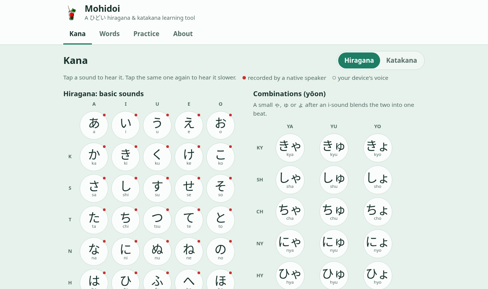

<div align=center>

# 🥃 [Mohidoi](https://mohidoi.com)
</div>
<p align="center">A ひどい hiragana, katakana and first-words learning site.</p>

Mohidoi v2 is a small static site for learning kana and everyday Japanese words with real recordings of a native speaker. It has no build step, no external fonts or scripts, no trackers and makes no requests to other sites.

## Sections

- **Kana**: hiragana and katakana charts with dakuten, handakuten, combinations (yōon), small っ and long vowels. Tap a sound to hear it; tap it again to hear it slower. A red dot marks sounds recorded by a native speaker; the rest use your device's own Japanese voice.
- **Words**: 1,358 recorded words with reading, romaji and English meaning. Search in kana, kanji, romaji or English, and filter by category (greetings and phrases, nouns, verbs, adjectives, numbers and time, countries and languages, chemical elements, other).
- **Practice**: short multiple-choice sessions (10 or 20 questions, four answers each):
  - hear a kana → pick the kana; see a kana → pick the romaji
  - hear a word → pick the meaning; see a word → pick the meaning; see a kanji word → pick the reading

  Missed items come back later in the same session and more often in later sessions (a simple Leitner-style box per item). Progress is stored in `localStorage` on your device only; the site works without it.
- **About**: how practice works, a progress reset button and credits.

And yes, the cow is still there.

## Running locally

```sh
python3 -m http.server 8000
# then open http://localhost:8000/
```

Any static file server works. The word list is a plain script (`data/words.js`), so nothing needs to be fetched with JavaScript.

Audio is Opus in Ogg (`audio/words/*.ogg`), which plays in Firefox and Chrome (desktop and Android). Safari support for Ogg Opus depends on the version.

## Layout

| Path | What |
| --- | --- |
| `index.html`, `styles.css`, `app.js` | the site |
| `js/romaji.js` | built-in Hepburn romaniser |
| `data/words.js` | word list (`window.WORDS`), generated |
| `audio/<hiragana>.wav` | kana recordings |
| `audio/words/<id>.ogg` | word recordings |
| `tools/fetch.py` | lists Fukujinzuke's recordings on Commons, downloads and converts them (rate-limited) |
| `tools/build_words.py` | matches each recording against JMdict and writes `data/words.js` |

To rebuild the data: download `jmdict-eng-*.json` from the [jmdict-simplified releases](https://github.com/scriptin/jmdict-simplified/releases) (not committed), then run `python3 tools/fetch.py <workdir> .` and `python3 tools/build_words.py <workdir>/list.json <jmdict-eng.json> .`

## Credits

- Recordings by [Fukujinzuke](https://commons.wikimedia.org/wiki/User:Fukujinzuke) via [Lingua Libre](https://lingualibre.org/) / Wikimedia Commons, [CC BY 4.0](https://creativecommons.org/licenses/by/4.0/) (word clips converted to Opus). See `audio/ATTRIBUTION.txt`.
- Dictionary data: [JMdict](https://www.edrdg.org/jmdict/j_jmdict.html) © EDRDG, [CC BY-SA 4.0](https://creativecommons.org/licenses/by-sa/4.0/), via [jmdict-simplified](https://github.com/scriptin/jmdict-simplified). `data/words.js` is a derived work under the same licence. Readings and meanings were matched automatically; words with no dictionary match are shown without a meaning.

<div align="center">
  <a href="https://mohidoi.com/"></a>
</div>
